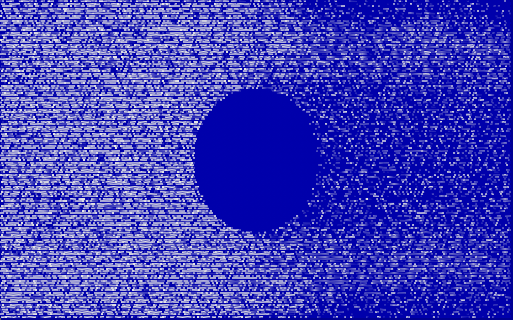

# lattice-gas-automata
Python simulation of lattice gas cellular automata

## Sources
1. [Wikipedia article on lattice-gas automata](https://en.wikipedia.org/wiki/Lattice_gas_automaton)
2. [Wikipedia article on Hardy–Pomeau–Pazzis (HPP) model](https://en.wikipedia.org/wiki/HPP_model)
3. [Investigation of a lattice gas model for surface gravity waves](https://www.researchgate.net/publication/241221646_Investigation_of_a_lattice_gas_model_for_surface_gravity_waves)

## HPP Model
```bash
python lgca4.py [source] [spawn]
```

Simulation runs at target 20 frames per second.

Specify space-separated digits for initial particle velocities, comma-separated values for source particle velocities.
- 0 = EMPTY (none)
- 1 = NORTH (up)
- 2 = SOUTH (down)
- 4 = EAST (right)
- 8 = WEST (left)

```python
class Channel(IntFlag):
    EMPTY = 0
    N = auto()
    S = auto()
    E = auto()
    W = auto()
```

## FHP-III Model
```bash
python lgca6.py [spawn]
```

Simulation runs at target 15 frames per second.

In this model each lattice side (grid cell) has 7 channels that can be occupied by a particle:
- 0 = EMPTY (none)
- 1 = SOUTHEAST
- 2 = SOUTHWEST
- 4 = WEST
- 8 = NORTHWEST
- 16 = NORTHEAST
- 32 = EAST
- 64 = REST (stationary)

